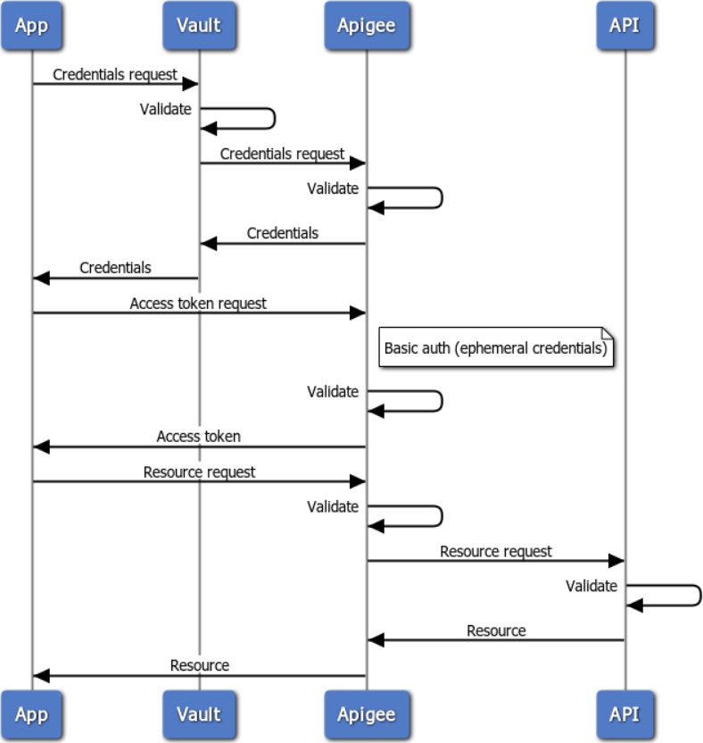
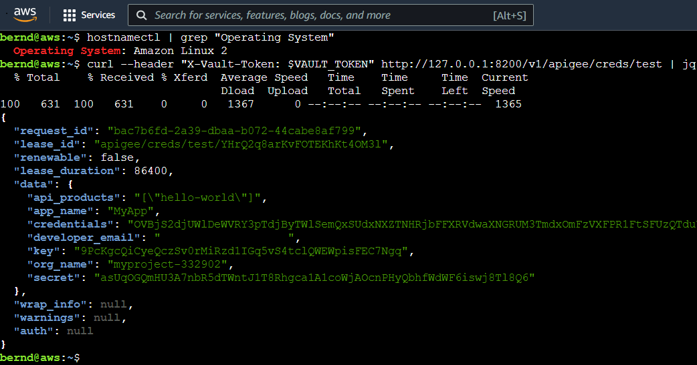
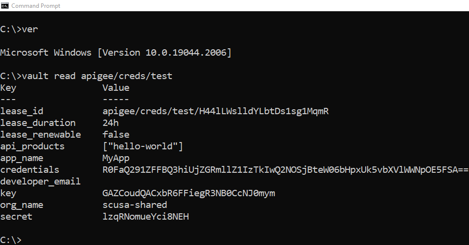

# Vault Plugin: Apigee Secrets Engine

[](https://pkg.go.dev/github.com/bstraehle/vault-plugin-secrets-apigee) [](https://github.com/bstraehle/vault-plugin-secrets-apigee/actions/workflows/ci.yml) [](https://goreportcard.com/report/github.com/bstraehle/vault-plugin-secrets-apigee) [](https://github.com/bstraehle/vault-plugin-secrets-apigee/releases)

[Vault](https://www.vaultproject.io/), a leader in secrets management, secures, stores, and tightly controls access to tokens, passwords, certificates, API keys, and other secrets in modern computing.

[Apigee](https://cloud.google.com/apigee), a leader in API management, helps companies design, secure, and scale application programming interfaces.

Apigee apps contain a consumer key and consumer secret (credentials), which are typically used to obtain an OAuth2 access token for API access. These credentials have an expiry, by default never. For **zero trust security** use cases, instead of apps using static, long-lived credentials, the **Vault Apigee secrets engine** generates dynamic, short-lived credentials, aka **ephemeral credentials**, automating frequent rotation.

## Table of Contents

1. [Use Case](#1-use-case)
2. [Examples](#2-examples)
3. [Prerequisites](#3-prerequisites)
4. [Get the Plugin](#4-get-the-plugin)
5. [Register Plugin](#5-register-plugin)
6. [Enable Secrets Engine](#6-enable-secrets-engine)
7. [Write Config](#7-write-config)
8. [Write Role](#8-write-role)
9. [Usage: CLI and API](#9-usage-cli-and-api)
10. [How It Works](#10-how-it-works)
11. [Upgrading from v1.1.x](#11-upgrading-from-v11x)
12. [Development](#12-development)
13. [References](#13-references)

## 1. Use Case



## 2. Examples

Linux, Vault API, and Apigee X



Windows, Vault CLI, and Apigee Edge for Private Cloud



## 3. Prerequisites

- [HashiCorp Vault](https://developer.hashicorp.com/vault/install)
- [Apigee X / hybrid](https://cloud.google.com/apigee/docs/) with a service account that can read and manage developer apps and delete app keys (e.g. the *Apigee API Admin* role), or
- [Apigee Edge](https://docs.apigee.com/) with a user that can manage developer apps
- An existing Apigee developer, developer app, and API product(s)
- Optional: [Go](https://go.dev/dl/) to build from source, [cURL](https://curl.se/download.html) and [jq](https://jqlang.org/download/) for the API examples

## 4. Get the Plugin

Download a release binary and verify its checksum:

```shell
VERSION=v1.2.0
OS_ARCH=linux-amd64   # also linux-arm64, darwin-amd64, darwin-arm64, windows-amd64, windows-arm64

mkdir -p vault/plugins && cd vault/plugins
curl -fsSLO https://github.com/bstraehle/vault-plugin-secrets-apigee/releases/download/$VERSION/vault-plugin-secrets-apigee-$OS_ARCH
curl -fsSLO https://github.com/bstraehle/vault-plugin-secrets-apigee/releases/download/$VERSION/checksums.txt
sha256sum --check --ignore-missing checksums.txt

mv vault-plugin-secrets-apigee-$OS_ARCH vault-plugin-secrets-apigee
chmod 700 vault-plugin-secrets-apigee
cd ../..
```

or build from source:

```shell
git clone https://github.com/bstraehle/vault-plugin-secrets-apigee.git
cd vault-plugin-secrets-apigee

go build -o vault/plugins/vault-plugin-secrets-apigee ./cmd/vault-plugin-secrets-apigee
```

## 5. Register Plugin

Add the plugin directory to the server configuration

```shell
cat > vault/server.hcl << EOF
plugin_directory = "$(pwd)/vault/plugins"
api_addr         = "http://127.0.0.1:8200"

listener "tcp" {
  address     = "127.0.0.1:8200"
  tls_disable = "true"
}

storage "file" {
  path = "/tmp/vault-data"
}
EOF
```

> Note: `tls_disable` and file storage are for local evaluation only. Use TLS and an HA storage backend (e.g. integrated storage) in production.

Start the server

```shell
vault server -config=vault/server.hcl
```

In a new terminal, initialize and unseal Vault

```shell
export VAULT_ADDR='http://127.0.0.1:8200'

vault operator init
vault operator unseal
```

Register the plugin

```shell
vault login

SHA256=$(sha256sum vault/plugins/vault-plugin-secrets-apigee | cut -d ' ' -f1)

vault plugin register -sha256=$SHA256 -version=v1.2.0 secret vault-plugin-secrets-apigee
```
```
Success! Registered plugin: vault-plugin-secrets-apigee
```

## 6. Enable Secrets Engine

Enable secrets engine

```shell
vault secrets enable -path=apigee -description="apigee secrets engine" vault-plugin-secrets-apigee
```
```
Success! Enabled the vault-plugin-secrets-apigee secrets engine at: apigee/
```

Optionally tune the default and max lease TTL, which apply to roles without a `ttl` and cap all roles

```shell
vault secrets tune -default-lease-ttl=1h -max-lease-ttl=24h apigee/
```

Disable secrets engine (optional)

```shell
vault secrets disable apigee
```

## 7. Write Config

Configure exactly one authentication method. `host` defaults to `https://apigee.googleapis.com` (Apigee X / hybrid).

Apigee X / hybrid with a service account key (recommended; access tokens are refreshed automatically)

```shell
vault write apigee/config credentials=@service-account.json
```

Apigee X / hybrid with a static access token (expires after one hour)

```shell
vault write apigee/config oauth_token="$(gcloud auth print-access-token)"
```

> Note: Instead of a service account key, you can use the [Google Cloud secrets engine](https://developer.hashicorp.com/vault/docs/secrets/gcp) to mint access tokens and write them to `oauth_token`.

Apigee Edge

```shell
vault write apigee/config host=$APIGEE_HOST username=$APIGEE_USERNAME password=$APIGEE_PASSWORD
```
```
Success! Data written to: apigee/config
```

Writing a field of a different authentication method replaces the configured method; e.g. `vault write apigee/config password=<new>` rotates only the Edge password.

Read config (optional; secrets are never returned)

```shell
vault read apigee/config
```
```
Key          Value
---          -----
auth_type    service_account
host         https://apigee.googleapis.com
```

Delete config (optional)

```shell
vault delete apigee/config
```

## 8. Write Role

Write role

```shell
vault write apigee/roles/test \
  org_name=$APIGEE_ORG_NAME \
  developer_email=$APIGEE_DEVELOPER_EMAIL \
  app_name=$APIGEE_APP_NAME \
  api_products=<PRODUCT_1>,<PRODUCT_2> \
  ttl=24h
```
```
Success! Data written to: apigee/roles/test
```

- `api_products` accepts a comma-separated list or a JSON array string such as `'["<PRODUCT_1>","<PRODUCT_2>"]'`.
- `ttl` is the lease duration *and* the expiry of the credentials in Apigee. It defaults to the mount's default lease TTL and is capped at the mount's max lease TTL.
- On update, omitted fields keep their values, e.g. `vault write apigee/roles/test ttl=1h`.

Read role (optional)

```shell
vault read apigee/roles/test
```
```
Key                Value
---                -----
api_products       [<PRODUCT_1> <PRODUCT_2>]
app_name           <APIGEE_APP_NAME>
developer_email    <APIGEE_DEVELOPER_EMAIL>
org_name           <APIGEE_ORG_NAME>
ttl                24h
```

List and delete roles (optional)

```shell
vault list apigee/roles
vault delete apigee/roles/test
```

## 9. Usage: CLI and API

Read creds

```shell
vault read apigee/creds/test
```
```
Key                Value
---                -----
lease_id           apigee/creds/test/<LEASE_ID>
lease_duration     24h
lease_renewable    false
api_products       [<PRODUCT_1> <PRODUCT_2>]
app_name           <APIGEE_APP_NAME>
credentials        RkRJTUdqbXJ1dDRmY2hTdUdKaEZETVZhNDAwN2MwM3NXQThEVEpobnJ3NTk3MmkzOkp2x...
developer_email    <APIGEE_DEVELOPER_EMAIL>
expires_at         2026-11-22T04:38:41Z
key                FDIMGjmrut4fchSuGJhFDMVa4007c03sWA8DTJhnrw5972i3
org_name           <APIGEE_ORG_NAME>
secret             JvmsfZaajNoqT6Ei7XAYmSTsTA8APSWdu9JxYKtZmEonZ862jKg3ROluxr6Bb710
```

`credentials` is `base64(key:secret)`, ready for the `Authorization: Basic` header of an OAuth 2.0 client credentials request.

> Note: The consumer secret is returned once and is not stored in Vault. Credentials are not renewable; read new ones before the lease expires.

Revoke lease (optional; deletes the key from Apigee)

```shell
vault lease revoke apigee/creds/test/<LEASE_ID>
```
```
All revocation operations queued successfully!
```

Read creds with the API

```shell
curl --header "X-Vault-Token: $VAULT_TOKEN" $VAULT_ADDR/v1/apigee/creds/test | jq
```
```json
{
  "request_id": "<REQUEST_ID>",
  "lease_id": "apigee/creds/test/<LEASE_ID>",
  "renewable": false,
  "lease_duration": 86400,
  "data": {
    "api_products": ["<PRODUCT_1>", "<PRODUCT_2>"],
    "app_name": "<APIGEE_APP_NAME>",
    "credentials": "RkRJTUdqbXJ1dDRmY2hTdUdKaEZETVZhNDAwN2MwM3NXQThEVEpobnJ3NTk3MmkzOkp2x...",
    "developer_email": "<APIGEE_DEVELOPER_EMAIL>",
    "expires_at": "2026-11-22T04:38:41Z",
    "key": "FDIMGjmrut4fchSuGJhFDMVa4007c03sWA8DTJhnrw5972i3",
    "org_name": "<APIGEE_ORG_NAME>",
    "secret": "JvmsfZaajNoqT6Ei7XAYmSTsTA8APSWdu9JxYKtZmEonZ862jKg3ROluxr6Bb710"
  },
  "wrap_info": null,
  "warnings": null,
  "auth": null
}
```

Revoke lease with the API (optional)

```shell
curl --header "X-Vault-Token: $VAULT_TOKEN" --request PUT \
  --data '{"lease_id": "apigee/creds/test/<LEASE_ID>"}' \
  $VAULT_ADDR/v1/sys/leases/revoke
```

Example policy for an application

```hcl
path "apigee/creds/test" {
  capabilities = ["read"]
}
```

## 10. How It Works

- Reading `creds/<role>` generates a new consumer key and secret on the role's developer app, associated with the role's API products and expiring in Apigee after the lease TTL. Expiry in Apigee is a backstop: if revocation fails, the key still stops working.
- The app's existing attributes and callback URL are preserved; the Apigee API would otherwise replace them on key generation.
- Credential generation is serialized per developer app so the newly created key is identified unambiguously.
- Revoking the lease (explicitly or on expiry) deletes the key from Apigee. Keys that are already gone are treated as revoked.
- Only the identifiers needed for revocation (org, developer, app, key) are persisted with the lease; the consumer secret is not.

## 11. Upgrading from v1.1.x

v1.2.0 is backward compatible with existing configuration, roles, and leases. Notable changes:

- `host` is optional and defaults to Apigee X / hybrid.
- New `credentials` config field (service account key JSON) with automatic token refresh.
- `api_products` is returned as a list instead of a JSON string. Existing roles are read transparently.
- `ttl` is optional on roles and is capped at the mount's max lease TTL. The Apigee expiry now always matches the lease.
- Role updates are partial; omitted fields keep their values.
- New `expires_at` field in credentials; the consumer secret is no longer persisted in lease storage.
- Role names in `creds/` are no longer lowercased, so they match the names used in `roles/`.

## 12. Development

```shell
go test ./...          # unit tests against an in-memory fake Apigee
golangci-lint run
```

Integration tests run against a real Apigee organization and are behind the `integration` build tag:

```shell
# Apigee X: APIGEE_OAUTH_TOKEN or APIGEE_CREDENTIALS (service account key JSON)
# Apigee Edge: APIGEE_HOST, APIGEE_USERNAME, APIGEE_PASSWORD
export APIGEE_ORG_NAME=<APIGEE_ORG_NAME>
export APIGEE_DEVELOPER_EMAIL=<APIGEE_DEVELOPER_EMAIL>
export APIGEE_APP_NAME=<APIGEE_APP_NAME>
export APIGEE_API_PRODUCTS=<PRODUCT_1>,<PRODUCT_2>

go test -tags integration -run Integration -v ./...
```

Releases are built by [GoReleaser](https://goreleaser.com/) when a `v*` tag is pushed (see `.github/workflows/release.yml`); the release is created as a draft for review. The plugin reports its version to Vault (`vault secrets list -detailed`).

## 13. References

- [Vault Plugin Portal (Official/Partner/Community)](https://developer.hashicorp.com/vault/integrations)
- [Vault Custom Secrets Engine Tutorial](https://developer.hashicorp.com/vault/tutorials/custom-secrets-engine)
- [GitHub: Apigee Client Library](https://github.com/bstraehle/apigee-client-go)
- [Credential: Google Certified Professional API Engineer](https://www.credential.net/92b59db2-d79e-4f61-810c-3e400d32f887#gs.c1xdhh)
- [Credential: HashiCorp Certified Vault Associate](https://www.credly.com/badges/87d28440-b845-4279-b44c-00f1cfdac049)
